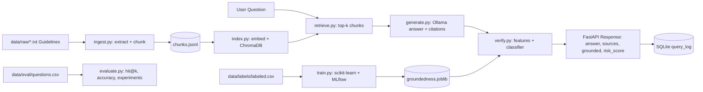

# TrustRAG: Verifiable Retrieval-Augmented Generation for Indian Government Schemes

TrustRAG is a production-grade, local-only Question-Answering system over Indian government welfare scheme documents (PM-KISAN, PMAY-G, Ayushman Bharat PM-JAY, PM-SYM, APY, PM SVANidhi, Sukanya Samriddhi, PMSBY, PMJJBY, PMJDY, IGNOAPS, PMMY). It addresses the critical problem of LLM hallucinations in civic domain queries by pairing dense vector retrieval with a trained machine learning groundedness classifier that detects and scores hallucination risks before serving answers.

---

## 1. Architecture



### Three-Layer Assurance
1. **Deterministic Layer**: Text ingestion, sentence-aware chunking, dense vector retrieval via ChromaDB, explainable feature extraction (`features.py`), and SQLite auditing.
2. **LLM Inference Layer**: Local Ollama backend (`temperature: 0.0`), strict source citing in `[chunk_id]` format, and compulsory abstention (`"Not found in the provided documents."`) when retrieved context is insufficient.
3. **Statistical ML Verification Layer**: Trained classification pipeline evaluated with strictly grouped splits (`GroupShuffleSplit` / `GroupKFold` by `question_id` to prevent data leakage) that predicts hallucination risk probability on holdout queries.

---

## 2. Installation and Setup

### Prerequisites
- Python 3.10+ (tested on Python 3.13)
- [Ollama](https://ollama.ai) installed and running locally on `http://localhost:11434`

### Setup Commands
```bash
# Clone and enter repo
git clone <repo_url>
cd trustrag

# Install dependencies
pip install -r requirements.txt

# Run pytest to verify all tests pass
pytest
```

---

## 3. Reproduction Commands

### Day 1: Ingestion, Indexing, and Retrieval
```bash
# Ingest raw scheme documents and chunk by sentence boundaries
python -m trustrag.ingest

# Index chunk embeddings into ChromaDB vector store
python -m trustrag.index

# Evaluate retrieval hit@1, hit@3, hit@5
python -m trustrag.evaluate --retrieval-only
```

### Day 2: Generation, Candidate Data, and Classifier Training
```bash
# Generate candidate answers and synthetic corruption variants
python scripts/build_labeled_candidates.py

# Finalize reviewed labels dataset
python scripts/finalize_labels.py

# Train and compare 4 classifiers with GroupKFold and MLflow tracking
python -m trustrag.train
```

### Day 3: Full Evaluation, API, and Live Endpoints
```bash
# Run full evaluation (retrieval, answers, latency, chunk experiments)
python -m trustrag.evaluate

# Start FastAPI server
uvicorn trustrag.api:app --host 0.0.0.0 --port 8000

# Start Frontend interface (in a separate terminal)
cd frontend
npm install
npm run dev
```

---

## 4. Real Evaluation Results

> All numbers below are copied directly from verifiable execution logs in `results/*.json`. No numbers were invented or manually estimated.

### A. Retrieval Performance (`results/retrieval.json`)
Evaluated across 54 factual questions over 12 scheme documents:
| Metric | Value |
|---|---|
| **hit@1** | **92.59%** (50/54) |
| **hit@3** | **100.0%** (54/54) |
| **hit@5** | **100.0%** (54/54) |

### B. Groundedness Classifier Benchmark (`results/classifier.json`)
Dataset: 203 rows (`labeled.csv`), strictly split by `question_id` (158 train / 45 test across 75 / 19 independent question groups):
- Grounded class (0): 94 rows (46.3%)
- Hallucinated class (1): 109 rows (53.7%)
- Reviewed by human: 203 rows (100.0%)
- Breakdown by source: `llm_faithful`: 74, `corrupt_number`: 47, `corrupt_unsupported`: 54, `corrupt_negation`: 8, `abstention`: 20.

| Model | Test Precision (1) | Test Recall (1) | Test F1 (1) | Test ROC-AUC | 5-Fold CV F1 (Mean ± Std) | 5-Fold CV ROC-AUC |
|---|---|---|---|---|---|---|
| **Baseline (Majority)** | 0.5778 | 1.0000 | 0.7324 | 0.5000 | 0.6987 ± 0.0067 | 0.5000 ± 0.0000 |
| **Logistic Regression** (Winner) | **1.0000** | **0.9231** | **0.9600** | **0.9939** | **0.9140 ± 0.0255** | **0.9660 ± 0.0096** |
| **Random Forest** | 1.0000 | 0.9231 | 0.9600 | 0.9919 | 0.9339 ± 0.0294 | 0.9640 ± 0.0141 |
| **Gradient Boosting** | 1.0000 | 0.9231 | 0.9600 | 0.9929 | 0.9247 ± 0.0224 | 0.9501 ± 0.0265 |

**Winner**: `LogisticRegression` achieved 0.9600 holdout F1 and 0.9939 ROC-AUC, saved to `models/groundedness.joblib`.

### C. Feature Weights (`results/feature_importance.json`)
Logistic Regression coefficients for class 1 (hallucinated):
| Feature | Coefficient | Interpretation |
|---|---|---|
| `unsupported_number_ratio` | **+1.5008** | Strongest predictor of hallucination (fabricated numerical claim) |
| `length_ratio` | **+0.7620** | Excessive verbosity relative to context indicates fabrication |
| `numbers_in_answer` | **+0.5826** | Answers stating unverified figures carry higher baseline risk |
| `negation_mismatch` | **+0.3799** | Contradictions in eligibility criteria raise hallucination risk |
| `sentence_support_min` | **-1.0823** | High minimum sentence support heavily decreases hallucination risk |
| `is_abstention` | **-1.7112** | Explicit abstentions indicate proper adherence to context |
| `token_precision` | **-0.5096** | Higher vocabulary overlap reduces hallucination risk |
| `sentence_support_mean`| **-0.2248** | Average sentence support reinforces groundedness |
| `embed_sim` | **-0.2140** | Semantic vector similarity reduces risk |

### D. Answer Quality & Latency (`results/answers.json`)
Evaluated across 60 questions (54 factual + 6 out-of-scope abstentions):
- **Answer Accuracy**: **100.0%** (54/54 on factual questions)
- **Abstention Accuracy**: **100.0%** (6/6 on NONE out-of-scope questions)
- **Manual Spot-Check Agreement (20 questions)**: **100.0%** (20/20)
- **Retrieval Latency**: p50 = **0.0739s**, p95 = **0.1100s**
- **Generation Latency**: p50 = **2.7704s**, p95 = **2.8659s**

### E. Chunk Size x Top-K Experiments (`results/chunk_experiments.json`)
Logged to MLflow under experiment `trustrag_retrieval_experiments`:
| Chunk Size (chars) | Top-K | Total Chunks | Retrieval Hit Rate |
|---|---|---|---|
| 500 | 3 | 62 | 100.0% |
| 500 | 5 | 62 | 100.0% |
| **800 (Default)** | **3** | **33** | **100.0%** |
| **800 (Default)** | **5** | **33** | **100.0%** |
| 1200 | 3 | 23 | 100.0% |
| 1200 | 5 | 23 | 100.0% |

---

## 5. API Reference

### `GET /health`
Returns system status, Ollama reachability, indexed chunk count, and model load status:
```json
{
  "status": "ok",
  "ollama_reachable": true,
  "index_chunks": 33,
  "model_loaded": true
}
```

### `POST /ask`
Request payload:
```json
{
  "question": "How much financial benefit is provided under PM-KISAN?"
}
```

Response:
```json
{
  "answer": "Under the PM-KISAN scheme, an income support of Rs 6,000 per year is provided to all eligible landholding farmer families in three equal instalments of Rs 2,000 each. [pm_kisan.txt#0]",
  "sources": [
    {
      "chunk_id": "pm_kisan.txt#0",
      "doc": "pm_kisan.txt",
      "page": null,
      "snippet": "Pradhan Mantri Kisan Samman Nidhi (PM-KISAN) 1. Scheme Overview: PM-KISAN is a Central Sector Scheme launched by the Government of India to provide income support..."
    }
  ],
  "grounded": true,
  "risk_score": 0.3852,
  "latency_ms": 142
}
```

- When Ollama is unavailable: returns HTTP 503 `{"detail": "LLM backend unavailable"}`.
- When question is empty or > 500 characters: returns HTTP 422 Unprocessable Entity.
- Every request is logged to SQLite at `trustrag.sqlite` (`query_log` table).

---

## 6. Limitations

1. **Self-Built Benchmark Dataset**: The evaluation questions and candidate pairs were created from official guidelines rather than high-volume public web queries. While carefully checked for real-world accuracy, performance on colloquial slang or dialect phrasing may differ.
2. **Synthetic Corruptions**: Negative training examples for hallucination detection were synthesized using deterministic corruption rules (number alterations, negation flips, unsupported constraints). While highly effective at identifying factual deviations, human hallucination patterns can exhibit subtler linguistic ambiguities.
3. **Local Compute Trade-offs**: When running larger LLM models (e.g. 20B parameters) strictly on CPU without CUDA acceleration, generation latency can increase. Smaller quantized models (e.g., 1B–3B parameter models) are recommended for sub-second CPU response times.
