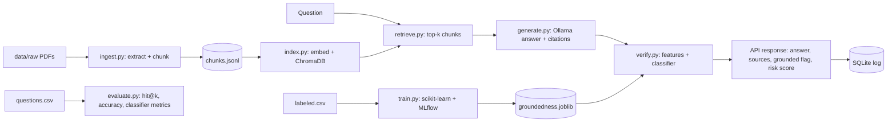

# TrustRAG: specification (CLAUDE-OWNED)

## 1. Problem
People miss government benefits because eligibility rules are buried in long PDFs, and plain LLMs invent criteria
with confidence. TrustRAG answers only from the documents, cites the source passage, and flags answers
that are probably not supported by that passage.

## 2. Scope
In: PDF/text ingestion, chunking, embeddings, retrieval, local-LLM answering with citations, a trained groundedness
classifier, an evaluation harness, a FastAPI service, SQLite query log, MLflow experiment tracking.
Out (do not build): auth, multi-language, fine-tuning an LLM, deployment automation, agent frameworks, voice.
Optional only if everything else is done: a small Streamlit page.

## 3. Architecture

Deterministic code: ingest, chunking, features, API. LLM inference: only `generate.py`. Trained ML: the classifier in `train.py`.

## 4. Repository layout (create exactly this)
```
src/trustrag/  config.py* features.py* ingest.py index.py retrieve.py generate.py verify.py train.py evaluate.py api.py db.py
tests/         test_features.py* test_ingest.py test_retrieve.py test_verify.py test_api.py
scripts/       build_labeled_candidates.py
data/raw/  data/eval/questions.csv  data/labels/labeled.csv  results/  models/  docs/
(* = already exists, CLAUDE-OWNED)
```

## 5. Data contracts
**chunks.jsonl** (one JSON per line): `chunk_id` (`<doc>#<n>`), `doc`, `page` (int or null), `text`, `char_start`.
**questions.csv**: `question_id, question, gold_answer, gold_doc, gold_snippet`. Target at least 50 rows over at least 10 documents,
including 5 or more questions whose answer is NOT in any document (`gold_doc` = `NONE`).
**labeled.csv**: `row_id, question_id, question, context, answer, label, source, reviewed`
- `label`: 0 = grounded, 1 = hallucinated (see LABELING_GUIDE)
- `source`: `llm_faithful | corrupt_number | corrupt_negation | corrupt_unsupported | abstention`
- `reviewed`: 1 once a human checked the row. Target about 300 rows, balanced to within 40/60.

## 6. Retrieval and generation
- Chunk by characters (`CONFIG.chunk_chars`, `CONFIG.chunk_overlap`), splitting on sentence boundaries where possible.
- Embeddings: `CONFIG.embed_model`; vector store: ChromaDB persisted at `CONFIG.chroma_dir`; cosine distance.
- Prompt rules for the LLM: answer only from the numbered context; cite as `[chunk_id]`; if the context lacks the answer,
  reply exactly `Not found in the provided documents.`; temperature 0.
- Ollama call via `httpx` to `/api/chat`, with timeout `CONFIG.llm_timeout_s`.

## 7. Verification (the ML part)
- Features come from `features.extract_features(answer, context, embed_sim)` with `context` = the concatenated retrieved chunks.
- Models to compare, with identical splits: majority-class baseline, LogisticRegression (scaled), RandomForest, GradientBoosting.
- Split: `GroupShuffleSplit` by `question_id`, 80/20, seed `CONFIG.random_seed`; also report 5-fold `GroupKFold` mean and std.
- Report for the **hallucinated class (1)**: precision, recall, F1, plus ROC-AUC and a confusion matrix. Save to `results/classifier.json`.
- Explain the winner: save coefficients or feature importances to `results/feature_importance.json`.
- Risk score = predicted probability of class 1. `grounded = risk < CONFIG.hallucination_threshold`.
- Abstention answers (`is_abstention` = 1) are always `grounded = true` and are not scored as hallucinations.
- Log every training run to MLflow (params, metrics, model). Experiment name `trustrag`.

## 8. Evaluation harness (`evaluate.py`)
Writes `results/retrieval.json` and `results/answers.json`:
- **hit@k**: the chunk containing `gold_snippet` appears in the top-k (k = 1, 3, 5). Match by normalized text containment.
- **answer accuracy**: record `gold_answer` and the generated answer for each question and mark correct or incorrect with a simple rule
  (key numbers and key terms from the gold answer are present). Spot-check 20 by hand and report the agreement.
- **abstention accuracy** on the NONE questions.
- **latency**: p50 and p95 seconds for retrieval and for generation.
- **Experiments:** chunk size {500, 800, 1200} x top_k {3, 5}, each logged to MLflow with hit@k.

## 9. API (FastAPI)
- `GET /health` returns `{status, ollama_reachable, index_chunks, model_loaded}`.
- `POST /ask` with body `{question: str (1..500 chars)}` returns
  `{answer, sources: [{chunk_id, doc, page, snippet}], grounded: bool, risk_score: float, latency_ms: int}`.
- Ollama unreachable returns 503 `{detail: "LLM backend unavailable"}`. Empty or overlong question returns 422. Every request is logged to SQLite
  (`ts, question, answer, grounded, risk_score, latency_ms`).

## 10. Definition of done
- `pytest` passes; `python -m trustrag.evaluate` and `python -m trustrag.train` produce the files in `results/`.
- `uvicorn trustrag.api:app` answers a real question end-to-end using real documents and a real Ollama model.
- README lists exact commands, real metrics copied from `results/`, and a Limitations section.
- Known limits are documented honestly (small self-built dataset, synthetic corruptions, 3B model quality).
